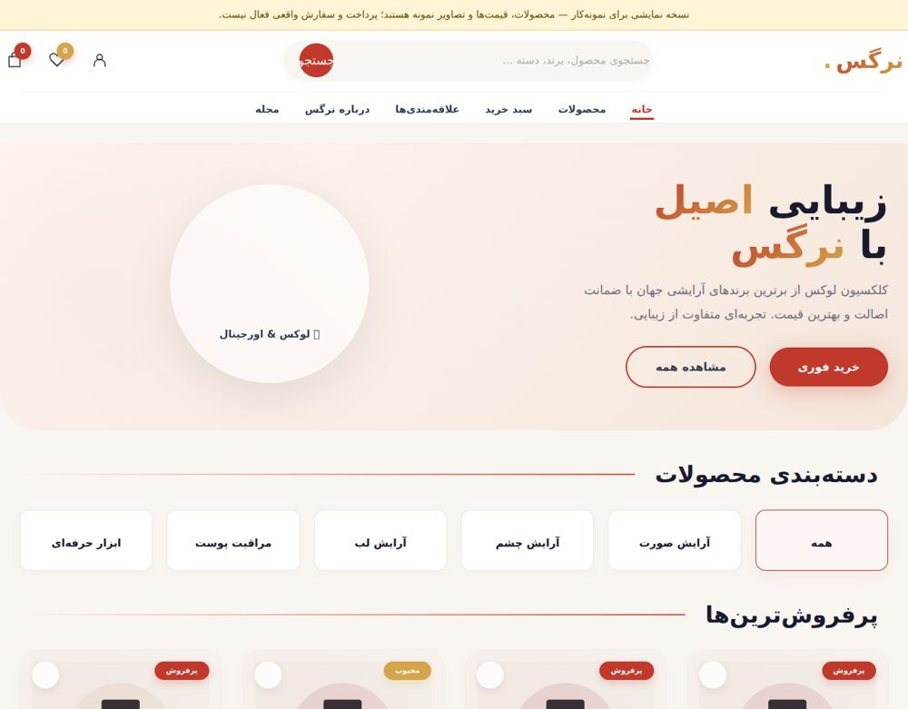

# Narges Beauty — Storefront Prototype

A Persian, right-to-left storefront interface with a filterable product catalogue, product details, a wishlist and a browser cart.



## Run locally

Requires Python 3 and Node.js for checks. From this repository directory:

```bash
python -m http.server 8000
```

For static sites, open http://localhost:8000. Vite prints its own local address. No hosting account is required.

## Source layout

`index.html` is the entrypoint. `styles.css` and `app.js` hold the interface and catalogue logic. `assets/` contains local product illustrations. The original Persian HTML filename redirects to the maintained entrypoint.

## Behavior and scope

Products, prices, reviews and packaging are demonstration data. Local SVG packaging illustrations are generic placeholders, not photographs of branded products. Cart and wishlist use localStorage; restored IDs and quantities are validated against the catalogue. Checkout is explicitly a preview and never charges or places an order.

## Checks

```bash
python scripts/check_project.py
```

See [validation results](docs/VALIDATION.md) and [review changes](docs/CHANGES.md). Automated checks live in `.github/workflows/`.

## Project history

Existing commits and source history have been retained. This maintenance pass does not add a repository-wide license grant; existing notices remain applicable.
